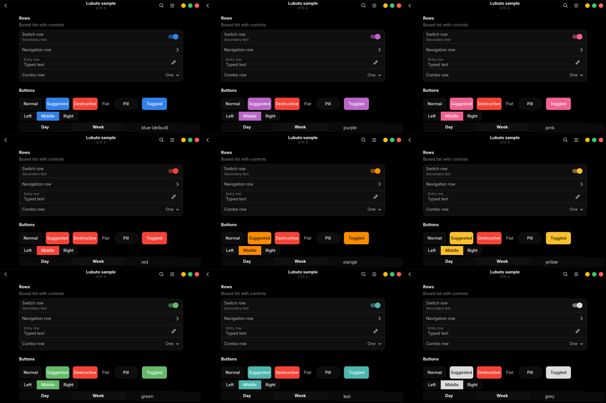

# Lubuto

Lubuto (Bemba: light) is a GNOME 50 theme with a Liquid Glass look, forked from
[Orchis](https://github.com/vinceliuice/Orchis-theme) by vinceliuice.

Two pieces make the look:

- **The theme**: GTK 3, GTK 4 and libadwaita stylesheets, plus the shell stylesheet, in nine colours, light
  and dark, standard and compact.
- **The extension**: `lubuto@richardmwaba.github.io` loads the shell stylesheet and owns every visual
  behaviour that a stylesheet cannot: blur behind the panel, popovers, overview and dock, rounded window
  corners with shadows, a macOS-style dock built on the shell's Dash, translucent window moves and wobbly
  windows.

The nine colours, dark compact, rendered from the GTK 4 sample window with the fixed accent:



## Requirements

- GNOME Shell 50 on Wayland. Nothing older is supported, and nothing else is tested.
- GTK 3.24, GTK 4.22 and libadwaita 1.9, the versions Fedora 44 ships.
- `node` and `npm` to build the stylesheets. The build pins Dart Sass (`sass-embedded`); a global `sass`
  works too.
- Optional: `git` and `curl` for the icon and cursor step, `flatpak` for the Flatpak step.

## Install

The reference setup, teal and dark and compact, with the GTK 4 link for libadwaita apps and the extension:

```sh
npm ci
./install.sh -t teal -c dark -s compact -l -e
```

Log out and back in once after the first extension install; GNOME Shell on Wayland loads new extension
code at login. The extension retires `user-theme` if it is enabled, since it loads the shell stylesheet
itself.

Everything the installer takes:

| Flag | What it does |
| --- | --- |
| `-t, --theme` | Colour: `default` (blue), `purple`, `pink`, `red`, `orange`, `yellow`, `green`, `teal`, `grey`, `all` |
| `-c, --color` | `standard`, `light`, `dark`; default is all three |
| `-s, --size` | `standard`, `compact`; default is both |
| `-l, --libadwaita` | Link the installed GTK 4 theme into `~/.config/gtk-4.0` |
| `-e, --extension` | Install and enable the shell extension |
| `-f, --fixed` | Fixed blue accent instead of following the GNOME accent colour |
| `--tweaks` | `solid`, `compact`, `black`, `primary`, `buttons`, `submenu`, `nord`, `dracula`, `noglass`; see `--help` |
| `--round` | Corner radius in px; default 16, which the extension's window corners match |
| `--fonts` | Crisp preset: Inter and JetBrains Mono, slight hinting, grayscale antialiasing |
| `--flatpak` | Let Flatpak apps read the theme and set `GTK_THEME` to the linked variant |
| `--firefox` | Lubuto window buttons in Firefox's own title bar, through `userChrome.css` |
| `--icons [hatter\|tela]` | Fetch the pinned icon theme in the variant that matches the colour |
| `--cursor [ice\|classic]` | Fetch Bibata-Modern-Ice or Bibata-Modern-Classic |
| `--full` | `-l -e --fonts --icons hatter --cursor ice` |
| `-d, --dest` | Install directory; default `~/.themes` |
| `-r, --remove` | Uninstall. With `-l`, `-e`, `--fonts`, `--flatpak` or `--firefox` it undoes that step only |

The icon and cursor steps download pinned upstream releases, verify them, and keep any directory that is
already there. Setting the GNOME keys is a separate y/N prompt, so an existing choice is never replaced
silently. Nothing third-party is redistributed; see `presets/icons.manifest`.

## Extension settings

Open them from Extensions, or `gnome-extensions prefs lubuto@richardmwaba.github.io`.

| Group | Settings |
| --- | --- |
| Variant | Colour, light or dark or follow the system, light style, compact, keep the GTK theme in sync |
| Glass blur | Blur on or off per surface (panel, overview, popovers, dock), radius, brightness, tint strength per surface |
| Window corners | Radius (16 px to match the theme), shadow, keep for maximized and fullscreen, blacklist |
| Dock | Icon size, monitor, hover magnify, reserve space, autohide, show-apps button |
| Window effects | Translucent move and resize with opacity and duration; wobbly windows with the Compiz spring parameters |

## Apps that draw their own window buttons

Mutter offers no server-side decorations on Wayland, so each app decides how its buttons look.

- GTK and libadwaita apps, GIMP and Electron apps with a native title bar: the theme handles them.
  Flatpak apps need `--flatpak` once.
- Firefox: `--firefox`, then untick "Title Bar" in Customize Toolbar and restart.
- Chrome: Settings, Appearance, choose **GTK**. Applies without a restart.

## Build the stylesheets only

```sh
npm ci
./parse-sass.sh
```

`npm run lint` checks the extension. `tools/check-gtk-css.py <3|4> file.css` parses a compiled stylesheet
with the real GTK parser, `tools/render-gtk.py <3|4> out.png` renders a sample window of common widgets
with the active theme, and `tools/screenshot.py out.png` takes a screenshot through the desktop portal,
with its dialog. `tools/measure.sh` and `tools/measure-frames.py` are the performance protocol in
`docs/MEASURING.md`. CI runs the build, the lint and the GTK parsers on every push.

## Layout

| Path | Contents |
| --- | --- |
| `src/_sass` | Sass sources: tokens, colours, GTK and shell partials |
| `src/gtk`, `src/gnome-shell` | Entry files per variant and the assets |
| `extension` | The shell extension: `src/<module>` per behaviour, schema, prefs |
| `presets` | fontconfig snippet, gsettings script, Firefox stylesheet, icon manifest |
| `tools` | Build, parse and render helpers |
| `docs/PLAN.md` | Scope, architecture, decisions and status |

## Licence

GPL-3.0-or-later, see [COPYING](COPYING). Orchis is by vinceliuice and is based on
[materia-theme](https://github.com/nana-4/materia-theme) by nana-4. Ported extension code is listed in
[extension/THIRD_PARTY.md](extension/THIRD_PARTY.md).
